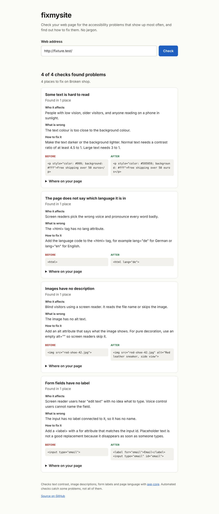

# fixmysite

Paste in a web address and fixmysite tells you what makes the page hard to use for people with disabilities, and how to fix each problem with a before and after example.

Most accessibility tools report things like "WCAG 1.4.3 color-contrast". That means nothing to someone running a small online shop. Since June 2025 the European Accessibility Act requires online shops in the EU to be accessible, and the [WebAIM Million 2026](https://webaim.org/projects/million/) report found problems on 95.9% of the top million home pages. Shop owners need answers they can act on.



## What it checks

The first version covers the four problems that show up most often:

- text that is too faint to read against its background
- images with no description for screen readers
- form fields with no label
- pages that don't say which language they are in

The checks come from [axe-core](https://github.com/dequelabs/axe-core). The explanations are my own, in `src/explanations.js`.

Automated checks find some problems, not all of them. A page that passes here can still be hard to use.

## Run it locally

You need Node.js 18 or newer.

```bash
git clone https://github.com/HaruFromSpace/fixmysite
cd fixmysite
npm install
npx playwright install chromium
npm start
```

Open http://localhost:3000.

From the terminal:

```bash
npm run check -- yourshop.com
```

## How it works

The server opens the page in a headless Chromium with Playwright, injects axe-core, runs only the four rules above and maps each result to a plain-language explanation. It refuses addresses on private networks and localhost, and runs at most two checks at once (`MAX_RUNNING`).

## Adding a check

1. Pick a rule from the [axe-core rule list](https://github.com/dequelabs/axe-core/blob/develop/doc/rule-descriptions.md) and add its id to `RULES` in `src/check.js`.
2. Write its plain-language explanation in `src/explanations.js`.
3. Add a broken example of it to `test/fixture.html`.
4. Run `npm test`. It fails if any rule finds nothing in the fixture, and it rebuilds the example report.

The start page lists checks from the server, so a new one shows up there on its own.

## Deploying

The repo includes a `Dockerfile` (based on the official Playwright image) and a `render.yaml`, so it runs on Render's free plan:

[](https://render.com/deploy?repo=https://github.com/HaruFromSpace/fixmysite)

The free plan has 512 MB of memory and sleeps after 15 minutes without visitors, so the first check after a quiet spell is slow. `MAX_RUNNING` is set to 1 there so only one browser runs at a time.

Any other host that runs Docker works too. Set `CHROMIUM_PATH` if you run it outside Docker and Chromium lives somewhere Playwright doesn't look.

## Next

- more rules, one at a time, each with its own explanation
- German translations of the report
- checking several pages of a site in one go
- a report you can download and send to whoever built the site

## License

MIT
